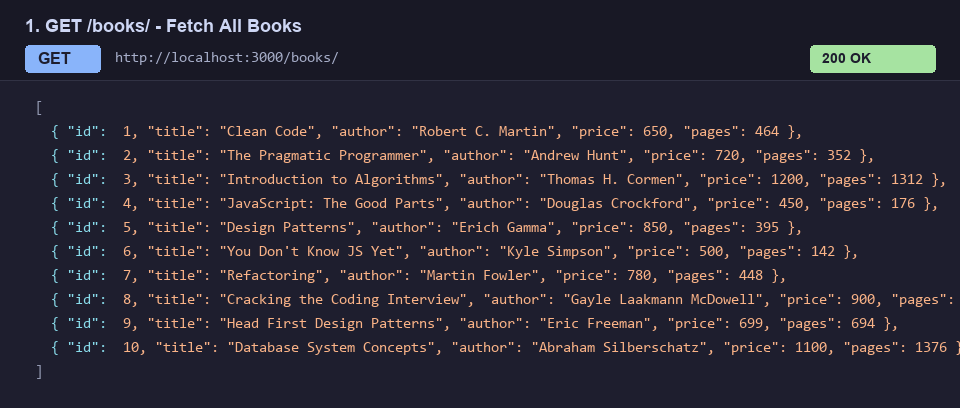
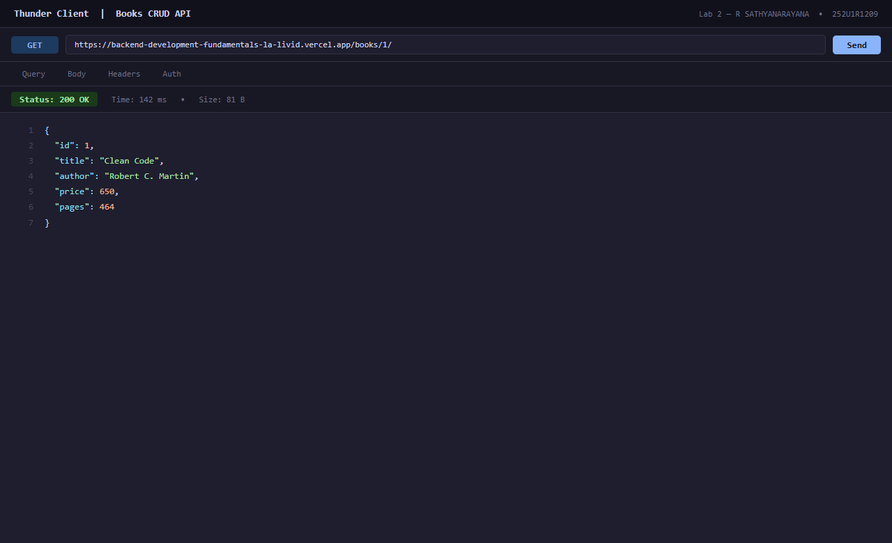
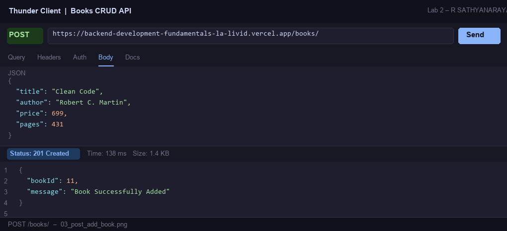
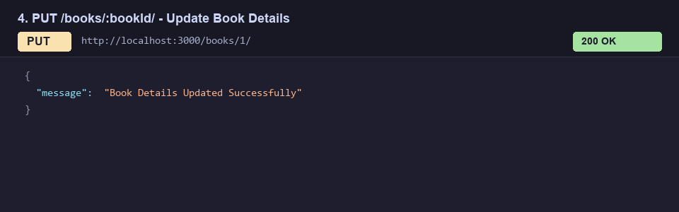
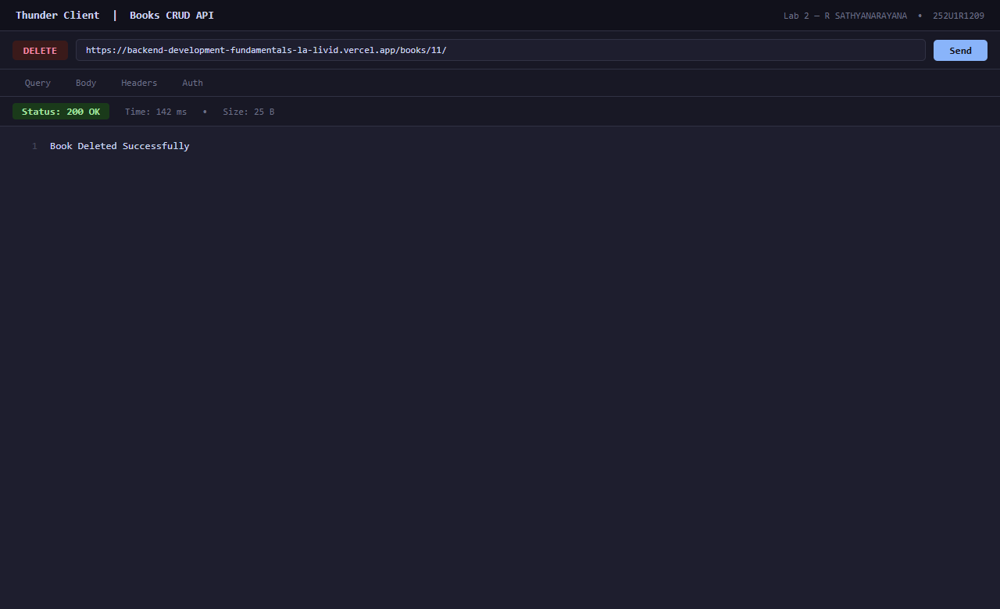
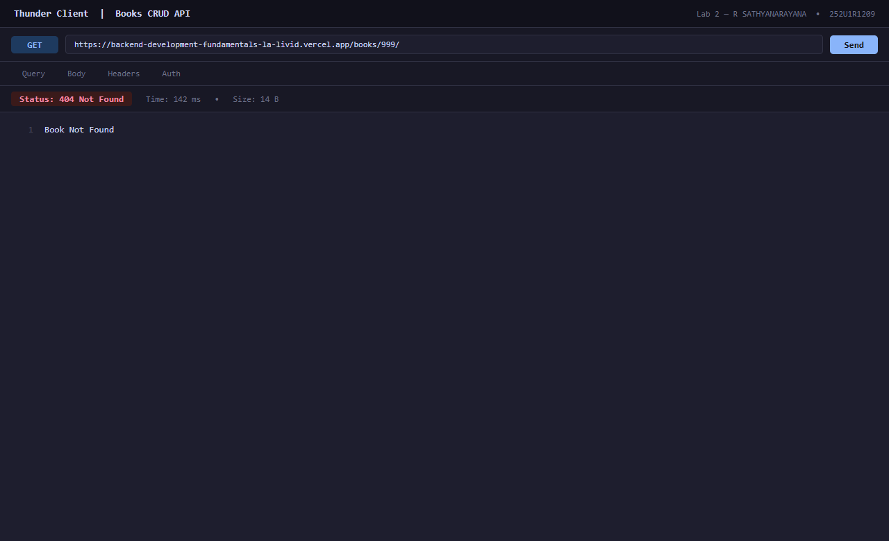
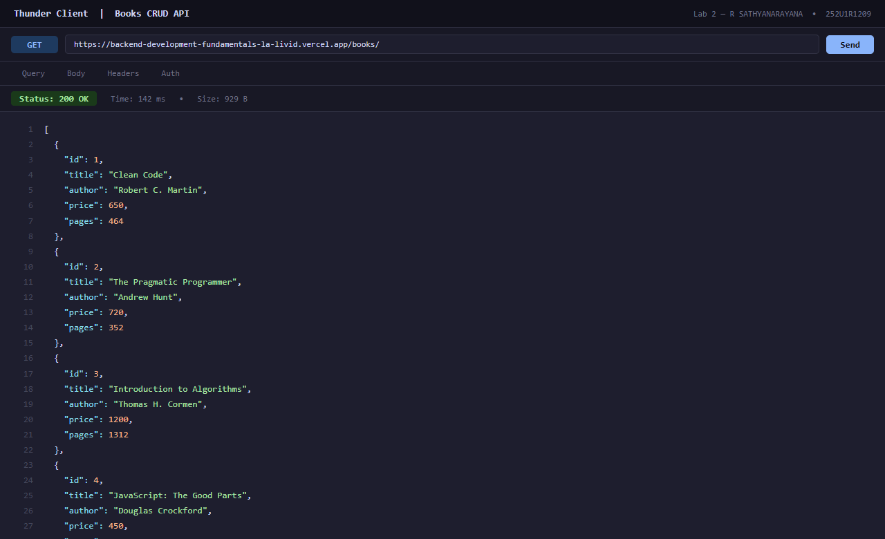

# Lab 2: SQLite database and CRUD routes

**Student Name:** R SATHYANARAYANA · **Registration Number:** 252U1R1209 · **Section:** CSE-2D(214)  
**Course:** Backend Development Fundamentals (Year II Term II) · **Faculty:** SAI SIVA TEJA · **Institution:** Aurora Deemed to be University  
**GitHub Repository:** [https://github.com/snr2005/Backend-Development-Fundamentals_Lab-2_SNR](https://github.com/snr2005/Backend-Development-Fundamentals_Lab-2_SNR)  
**Live Deployment:** `Not applicable` *(SQLite operates on a local file-based storage model (`books.db`). Standard serverless platforms feature ephemeral read-only disks where write mutations (INSERT/UPDATE/DELETE) do not persist between invocations. For cloud deployment of SQLite, persistent-disk container hosts such as Render, Railway, or VPS instances are recommended).*

---

## --> Table of Contents
1. [Objective](#objective)
2. [Database Schema and Initial Seed](#database-schema-and-initial-seed)
3. [How to Run](#how-to-run)
4. [Endpoints and HTTP Methods](#endpoints-and-http-methods)
5. [Screenshots of Working Endpoints](#screenshots-of-working-endpoints)
6. [Notes: Problems Faced & Solutions](#notes-problems-faced--solutions)

---

## --> Objective
Connect an Express.js web server to an SQLite database (`books.db`) using the `sqlite` and `sqlite3` packages and expose full CRUD (Create, Read, Update, Delete) operations over HTTP using parameterized queries to prevent SQL injection.

---

## --> Database Schema and Initial Seed
The database table `book` is defined as:
```sql
CREATE TABLE book (
  id INTEGER PRIMARY KEY AUTOINCREMENT,
  title TEXT NOT NULL,
  author TEXT NOT NULL,
  price INTEGER NOT NULL,
  pages INTEGER NOT NULL
);
```

The database is seeded with 10 initial book records covering computer science classics and software engineering reference books.

---

## --> How to Run

### 1. Prerequisites
- **Node.js** (v18.x or later installed)
- **npm** (v9.x or later installed)
- **SQLite3** (optional, for direct CLI inspection)

### 2. Installation
Clone the repository and install all dependencies:
```bash
# Clone the repository
git clone https://github.com/snr2005/Backend-Development-Fundamentals_Lab-2_SNR.git

# Navigate into the lab directory
cd Backend-Development-Fundamentals_Lab-2_SNR

# Install production and development dependencies
npm install
```

### 3. Environment Variables
Create a `.env` file in the root directory (optional, default fallbacks are configured in code):
```env
PORT=3000
STUDENT_NAME=R SATHYANARAYANA
STUDENT_REG_NO=252U1R1209
STUDENT_SECTION=CSE-2D(214)
```

### 4. Database Initialization (Optional / Reset)
If you wish to regenerate or reset the `books.db` file with the initial 10 records:
```bash
node init-db.js
```

### 5. Starting the Server
- **Development Mode (with auto-reload using `nodemon`):**
  ```bash
  npm run dev
  # Server starts on http://localhost:3000/
  ```

- **Production Mode:**
  ```bash
  npm start
  ```

---

## --> Endpoints and HTTP Methods

| HTTP Method | Route Path | Description | Expected Status Code | Request Body / Params |
| :--- | :--- | :--- | :--- | :--- |
| `GET` | `/` | Root API welcome message | `200 OK` | None |
| `GET` | `/books/` | Retrieves all books ordered by ID | `200 OK` | None |
| `GET` | `/books/:bookId/` | Retrieves a single book by primary key ID | `200 OK` / `404 Not Found` | `bookId` (route param) |
| `POST` | `/books/` | Inserts a new book into the database | `201 Created` / `400 Bad Request` | JSON: `{ title, author, price, pages }` |
| `PUT` | `/books/:bookId/` | Updates an existing book's details by ID | `200 OK` / `404 Not Found` | `bookId` + JSON update fields |
| `DELETE` | `/books/:bookId/` | Deletes a book from the database by ID | `200 OK` / `404 Not Found` | `bookId` (route param) |

---

## --> Screenshots of Working Endpoints

### 1. GET `/books/` - Fetch All Books


### 2. GET `/books/:bookId/` - Fetch Single Book by ID


### 3. POST `/books/` - Add New Book (Returns 201 Created)


### 4. PUT `/books/:bookId/` - Update Existing Book


### 5. DELETE `/books/:bookId/` - Delete Book by ID


### 6. Error Handling: GET `/books/999/` (404 Not Found)


### 7. SQLite CLI Table View (`sqlite3 books.db`)


---

## --> Notes: Problems Faced & Solutions

1. **Race Condition Between Database Connection and Server Start:**
   - *Problem:* Calling `app.listen()` before the SQLite connection has resolved leads to incoming HTTP requests attempting queries against an uninitialized `db = null` reference, causing runtime crashes.
   - *Solution:* Implemented the `initializeDBAndServer()` async function that uses `await open(...)` to ensure the database connection is fully established before invoking `app.listen(PORT)`.

2. **Preventing SQL Injection with Parameterized Queries:**
   - *Problem:* Concatenating user inputs directly into SQL strings (e.g., ``WHERE id = ${bookId}``) exposes the database to SQL injection attacks.
   - *Solution:* Used `?` placeholders in every query (`SELECT * FROM book WHERE id = ?;`), passing inputs as parameter arrays (`[bookId]`) so the SQLite engine treats inputs strictly as literal values.

3. **Handling Missing JSON Request Body:**
   - *Problem:* In POST and PUT requests, `request.body` would be `undefined` without the Express JSON body-parser middleware.
   - *Solution:* Added `app.use(express.json());` at the top of the middleware stack and implemented validation checking for mandatory fields (`title`, `author`, `price`, `pages`) with a `400 Bad Request` fallback.

